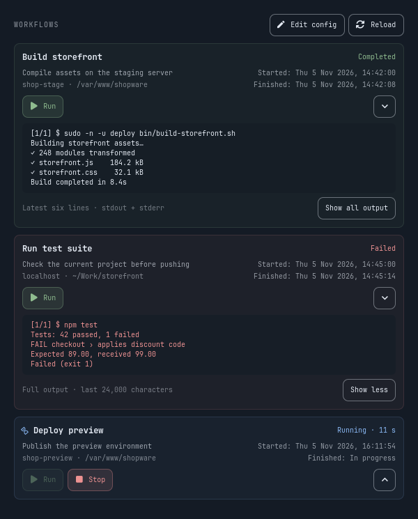

# Workflows for Omarchy

A native bar plugin for one-click local and SSH workflows. Its cards, Run buttons and inline console follow the DDEV plugin's design and your current Omarchy theme.



Click the lightning icon in the bar, then **Run** on a workflow. Output streams into that workflow's card, combining stdout and stderr. The console is selectable and shows the latest six lines; **Show all output** expands it inside the panel's single scrollbar. Failures expand automatically. Each workflow retains up to 24,000 characters in memory. Hiding the console or closing the panel keeps the command running.

Different workflows can run concurrently. Repeated clicks cannot start the same workflow twice, including from a second plugin instance. **Stop** terminates the local command process group; the default timeout is 30 minutes. An elapsed timer and spinner show active work. Each card shows the most recent start time, finish time and result. Times use your local timezone and Omarchy display locale. Latest-run summaries persist across shell restarts; console output remains in memory for the shell session and resets on the next run. Workflows without a saved summary show “Last run: Not recorded yet”; runs from older plugin versions cannot be reconstructed.

Desktop notifications announce completion, failures, timeouts and cancellation even when the panel is closed. Failure and timeout alerts use critical urgency. Opening or reloading the panel never replays old alerts. Set `"notifications": false` on an individual workflow to silence it (the default is `true`). If delivery fails, the card shows a warning while preserving the actual command result.

Latest summaries live in `$XDG_STATE_HOME/omarchy/workflows/<id>.json` (default `~/.local/state/omarchy/workflows/`), outside the plugin installation. Files are private (`0600`) in a private directory (`0700`) and store only run ID, start/completion times, status and exit code. They do not contain commands, workflow names or console output. A saved Running entry without a live runner becomes Interrupted with an unknown completion time; that does not establish the remote process's status.

## Install

Requires Omarchy's Quickshell bar, Python 3 and OpenSSH for remote workflows. Desktop notifications also require `python-gobject` (PyGObject with Gio/GLib), available as an Arch Linux package. There are no pip dependencies.

Install with Omarchy:

```sh
omarchy plugin add https://github.com/ianzano/omarchy-workflows.git --enable
```

On first installation, copy the example config without replacing an existing file:

```sh
config_home="${XDG_CONFIG_HOME:-$HOME/.config}"
cp -n "$config_home/omarchy/plugins/ianzano.workflows/workflows.example.json" \
  "$config_home/omarchy/workflows.json"
```

Edit the host, working directory and commands before running the example. The example host `shop-stage` is a placeholder for an alias in your SSH config. Opening the plugin never executes a workflow.

To install from a local checkout instead:

```sh
git clone https://github.com/ianzano/omarchy-workflows.git
cd omarchy-workflows
python3 install.py
```

Installs to `~/.config/omarchy/plugins/ianzano.workflows/` and enables the widget using Omarchy's plugin command. The installer backs up existing plugin files and bar configuration before updating them. Existing workflow config is preserved. All customizations stay outside `/usr/share/omarchy/`.

For a Git-managed installation, update with:

```sh
omarchy plugin update ianzano.workflows
```

For a manual installation, pull the repository and rerun `python3 install.py`. If the shell retains the previous panel after an update, let running workflows finish, then run `omarchy restart shell`.

## Configure

Edit `~/.config/omarchy/workflows.json` (**Edit config** opens your Omarchy editor). `$XDG_CONFIG_HOME` is respected. **Reload**, middle-clicking the widget, reopening the panel, or its five-second refresh while open picks up changes. Invalid config shows an error and prevents execution. Nothing executes merely by loading config.

Example SSH build and local checks:

```json
{
  "version": 1,
  "workflows": [
    {
      "id": "build-stage",
      "name": "Run build on stage",
      "description": "Build the Shopware storefront as deploy",
      "host": "shop-stage",
      "cwd": "/var/www/shopware",
      "timeout": 1800,
      "steps": [
        ["sudo", "-n", "-u", "deploy", "bin/build-storefront.sh"]
      ]
    },
    {
      "id": "local-checks",
      "name": "Run local checks",
      "cwd": "/home/you/projects/storefront",
      "steps": [
        ["npm", "run", "lint"],
        "npm test && npm run build"
      ]
    }
  ]
}
```

- `id`: stable, unique identifier using letters, numbers, underscores or dashes; starts with a letter or number.
- `name`: card title. `description` is optional.
- `host`: optional SSH alias or `user@hostname`. Omit for local execution. Configure ports, keys, jump hosts and usernames in `~/.ssh/config`.
- `cwd`: working directory, on the remote machine when `host` is present. Use an absolute path; `~` and environment variables in this field are literal.
- `steps`: ordered commands. Argument arrays pass arguments literally; strings support shell syntax through `sh -ec`. Execution stops on a failed step. Each step gets a separate shell in the configured directory, so shell variables and `cd` do not carry across steps. Use one string or a script when you need shared shell state. Shell failure semantics apply to pipelines; use an explicit Bash script with `set -euo pipefail` when needed.
- `notifications`: optional boolean; defaults to `true`.
- `timeout`: optional integer in seconds, 1–86400; defaults to 1800.

The stage command runs over SSH, changes to `/var/www/shopware`, then runs `sudo -n -u deploy bin/build-storefront.sh`. `-n` makes sudo fail visibly if it needs a password. Set up SSH key/agent authentication and permission to run the build as deploy beforehand. SSH uses batch mode and a ten-second connection timeout; first-time host trust must be established through your terminal. The panel does not accept interactive password prompts. Your normal desktop SSH environment is inherited.

**Stop** and timeout terminate the local SSH client. A remote process may survive disconnection depending on the server and command; check the server before retrying an interrupted build. Local child processes that create their own sessions may also outlive the runner. Commands are noninteractive and have no terminal; programs can buffer output, so use their unbuffered option when immediate progress matters.

Workflow files contain trusted executable code. Commands run with your account's privileges and SSH account permissions. Output and command arguments may contain sensitive data; avoid embedding credentials. The plugin has no background network polling, telemetry or disk log storage. Only clicking Run connects to a configured SSH host. Console output is always plain text.

## Check and test

```sh
python3 backend.py check
python3 backend.py run build-stage
omarchy plugin validate .
python3 -m unittest -v test_backend test_history test_notifications
dbus-run-session -- python3 tests/notifications_bus.py
python3 test_ui.py
python3 tools/render_preview.py
```

`backend.py run` executes the selected workflow, so use it intentionally. Automated tests use temporary local commands and simulated SSH shell strings, never your configured server. Backend checks cover literal arguments, SSH quoting, failure propagation, streaming, timeout, cancellation, process cleanup, duplicate-run locking and malformed config. The UI test loads the real plugin and runner through Quickshell in the desktop Wayland session, checking concurrency, literal markup display, status, Stop, and expanded output. History checks cover saved timestamps/status, independent concurrent records, interruption recovery, private storage and notification delivery failures. Notification tests inspect escaped markup and urgency; the isolated D-Bus test runs real workflows against a test notification service without alerting the desktop. The UI test also verifies timestamps and status after recreating the panel. The preview renderer uses synthetic data in an isolated offscreen window.

IPC: `omarchy-shell ianzano.workflows open`, `close`, or `toggle`.

Remove with:

```sh
omarchy plugin remove ianzano.workflows
```

Your separate `workflows.json` and latest-run summaries remain available for reuse. To erase them too, remove `omarchy/workflows.json` from your config directory and `omarchy/workflows/` from your state directory yourself.

## Marketplace

The root manifest, MIT license, synthetic preview and this README follow the [Omarchy publishing guide](https://plugins.omarchy.org/publish.html). The repository can be installed directly through Omarchy; marketplace listing additionally requires submission and maintainer approval.

MIT licensed.
